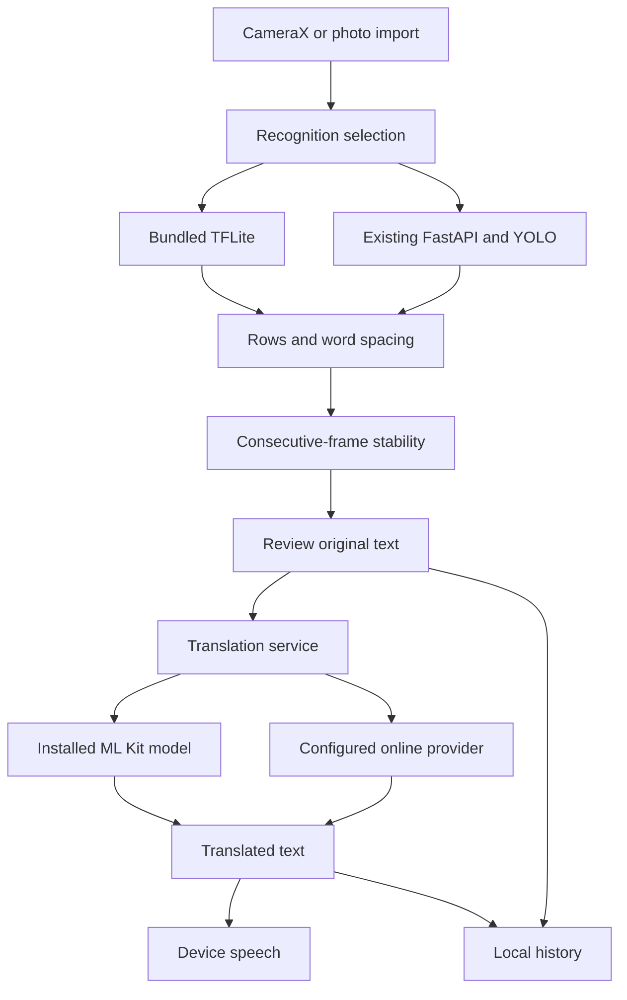

# SCIOBRAILLE architecture

The existing native Kotlin Views app and FastAPI backend are retained. No unrelated frontend or replacement model was introduced.

| Concern | Implementation |
|---|---|
| Camera | Existing CameraX preview/capture plus ImageAnalysis KEEP_ONLY_LATEST, one executor, minimum 750 ms between samples; rotate to upright before inference |
| Image import | `BrailleImageLoader`: byte/pixel limits, sampled decode and EXIF orientation; imported preview uses the same letterboxing as overlays |
| Device model | Existing `OfflineBrailleDetector`/LiteRT, quantized input and output handling, shape validation, duplicate suppression, 300-cell cap |
| Recognition selection | Device first in Auto, server on uncertain result; Online preferred or strict Offline only preferences; failed server calls back off |
| Reconstruction | Cell centers, row clustering and spacing; consistent mild geometric deskew. It is not full document perspective rectification |
| Stability | `ScanSession`: two consecutive identical readings, empty-frame reset, duplicate-save suppression. Stability does not imply correctness |
| UI state | Original/raw/corrected/translated values separate. Request IDs plus source/language comparisons reject stale asynchronous translations |
| Translation | `TranslationRepository`, `MlKitTranslationFallback`, `LanguagePicker`; provider adapters in `translation_service.py` |
| Speech | `MultilingualTtsManager`: locale/voice selection, rate, chunking, play/pause/resume/replay/stop, audio focus, offline-voice filtering |
| History | Existing SharedPreferences JSON, bounded to 50; originals and translated variants, search/date filters/reuse/delete/share |
| Learning | Existing Room database, curriculum, practice/scoring/progress and six levels preserved. Cloud sync disabled pending authenticated accounts |
| Preferences | Existing store extended with theme, mirror override, voice, size/contrast and processing preferences |

## API boundaries

`/api/scan-frame` accepts multipart images; `/ws/scan` accepts binary frames. Both call the same locked real inference function in a worker thread. Responses contain original-coordinate normalized boxes, image dimensions, raw text, confidence and stability. Images are processed in memory; client stability history is bounded. Pixel and payload bounds are checked before inference.

`/api/languages` exposes provider-supported targets. `/api/translate` validates JSON, source/target and a 4000-character/32 KB limit. The official Google v2 adapter supports source auto-detection when requested. LibreTranslate advertises only its installed pairs reachable from English. The device local path never downloads implicitly. English passthrough is identified as local source text.

`recognition_capabilities.py` is the extension point for new Braille systems. A future system needs a model class schema, a validated decoder (including indicators/contractions), datasets and independent accuracy evidence before `enabled=true`. Teaching mappings and standard Unicode Braille encoding do not qualify as camera-model support.

## Deployment and security

Run the model API behind an HTTPS reverse proxy; bind Uvicorn to loopback/private network. Use one model worker per allocated inference process and apply concurrency limits. At the proxy set a 21 MB body limit, per-client rate/concurrency limits and WebSocket upgrade/timeouts. Restrict upstream traffic and paid translation quotas before a public rollout. No client-embedded shared API secret is treated as user authentication.

The code does not include production account authentication or a public paid-provider abuse-prevention system. Default deployment is local/private. The unauthenticated school router is not mounted unless explicitly enabled for development. Do not expose it publicly. Images/text go to the configured server/provider only when online processing is permitted; device history and lesson data are excluded from Android backup/transfer. Provider retention is controlled by the deployment/provider, not by this app.

The community adapter is preserved only as an opt-in evaluation provider. Its third-party web behavior is less reliable than official Google/Libre APIs and must not be used to assert production availability. Official provider credentials stay in backend environment variables.

## Design and accessibility

Purple/teal palette with light/dark/high-contrast variants, a six-dot S brand mark, native launch screen, first-use onboarding, dashboard, scanner, results, photo import, languages, history, learning, settings and Help. Results live with the scanner so users can review/translate without losing their camera context. Translation output uses locale-aware direction/Unicode. Native controls are keyboard/screen-reader reachable, use semantic labels and 48 dp minimum targets, and scale with device/app text settings. Human TalkBack and large-font testing are still required; no accessibility certification is claimed.
